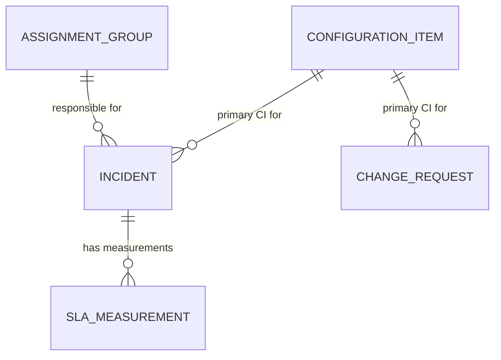

# ITSM Data Warehouse Conceptual Data Model

## Purpose

This conceptual model identifies the main business things the proposed
fictional ITSM Data Warehouse needs to represent and the relationships between
them. It is based on the business requirements in
[`business_requirements.md`](./business_requirements.md).

The model is a high-level view for discussing business meaning and scope. It
does not define database tables, columns, data types, keys, indexes, or SQL. It
is an initial model for a learning project, not a complete representation of
every possible ITSM process.

## Scope

The model includes five conceptual entities:

- Incident
- SLA Measurement
- Assignment Group
- Configuration Item
- Change Request

It captures primary relationships for the initial version. In particular, an
incident can have multiple SLA measurements. The one-primary-CI-per-incident
and one-primary-CI-per-change-request relationships are simplifying assumptions
for this version, not universal ITSM rules.

## Entity and attribute

An **entity** is a kind of business thing about which the warehouse needs to
keep information, such as an Incident or Configuration Item. An **attribute**
is a piece of information that describes one instance of an entity, such as an
incident's status or a group's name. This conceptual model names the entities
but deliberately does not define detailed attributes.

## Entity definitions

| Entity | Business meaning |
| --- | --- |
| **Incident** | An IT incident that requires investigation or resolution. It is associated with a primary assignment group, a primary configuration item under the initial assumption, and zero or more SLA measurements. |
| **SLA Measurement** | An individual measurement of an SLA obligation associated with an incident, such as a response-time or resolution-time measurement. A measurement is not the same thing as the incident itself. |
| **Assignment Group** | A team responsible for handling incidents. For the initial model, an incident is associated with one primary group in its final recorded state. |
| **Configuration Item** | An IT component, such as a fictional application, server, or database, that may be affected by an incident or change request. |
| **Change Request** | A planned modification to an IT service or configuration item. For the initial model, each change request is associated with one primary configuration item. |

## Relationships and cardinalities

Cardinality describes how many instances of one entity may be related to an
instance of another entity. In the descriptions below, “one” and “many” refer to
the initial assumptions represented in the diagram.

| Relationship | Cardinality | Plain-English meaning |
| --- | --- | --- |
| Assignment Group to Incident | One Assignment Group to zero or many Incidents; each Incident has one primary Assignment Group in its final recorded state. | A group may be responsible for many incidents. Each incident is assigned to one primary group for this initial model. This does not assert that the group never changed earlier in the incident's history. |
| Configuration Item to Incident | One Configuration Item to zero or many Incidents; each Incident has one primary Configuration Item in this initial version. | A CI may be associated with many incidents. To keep the first model simple, each incident has one primary CI. Some real incidents may affect several CIs or none. |
| Incident to SLA Measurement | One Incident to zero or many SLA Measurements; each SLA Measurement is associated with one Incident. | One incident can have separate measurements, for example a response-time measurement and a resolution-time measurement. An incident may have no measurement recorded or eligible for analysis. |
| Configuration Item to Change Request | One Configuration Item to zero or many Change Requests; each Change Request has one primary Configuration Item in this initial version. | A CI may be affected by many change requests. The initial model assigns each change request one primary CI; changes affecting multiple CIs are not represented yet. |

The `o{` end of the diagram means zero or many. A crow's-foot end marked `||`
means exactly one. For example, an Incident is linked to zero or many
measurements, while each SLA Measurement belongs to exactly one Incident in
this initial model.

## Conceptual ER diagram

## Business assumptions

1. The project uses only synthetic information for a fictional company's ITSM
   operations.
2. An Incident has one primary Assignment Group in its final recorded state.
   The model does not imply that assignment was constant over the incident's
   full history.
3. An Incident has one primary Configuration Item in the initial version. This
   is a simplifying assumption, not a general rule for ITSM incidents.
4. An Incident can have zero or many SLA Measurements. Multiple measurements
   can represent different obligations, such as response and resolution.
5. Each SLA Measurement is associated with one Incident in this initial model.
6. A Change Request has one primary Configuration Item in the initial version.
   A CI may be associated with many change requests.
7. Each Change Request is represented as affecting one primary CI; broader
   many-CI changes are outside this simplified relationship.

These are conceptual business assumptions. Whether a relationship is mandatory
in all source records, how missing or unmatched references are handled, and how
history is stored need further agreement.

## Limitations

- The model does not show detailed attributes, identifiers, or implementation
  structures.
- It does not show the history of incident status, priority, assignment-group,
  or CI changes. In particular, the final recorded assignment group does not
  explain which groups handled an incident earlier.
- One primary CI per incident and per change request cannot represent a
  many-CI relationship or cases with no related CI.
- The model permits zero SLA measurements per incident. It does not define SLA
  eligibility, target values, clock rules, pauses, resets, or the boundary
  condition for determining a breach.
- It does not define change outcomes or which outcomes qualify as failed.
- It is not the logical model, physical schema, or analytical star schema.

## Open questions

The following questions from the business requirements may change or refine
this conceptual model:

1. Can an incident or change request be related to multiple CIs, and can either
   exist without a CI relationship?
2. Does every incident require an assignment group, and should the model retain
   every group responsible over time rather than only the final recorded group?
3. Can assignment groups or CIs be renamed, reorganized, or otherwise change in
   ways that require historical versions?
4. Can an SLA Measurement ever apply to more than one incident, or is it always
   specific to one incident?
5. What is the business grain of an SLA Measurement? Can one incident have
   repeated measurements of the same SLA type or measurements for separate
   stages?
6. Which incidents and SLA measurements are eligible for breach analysis, and
   how are missing or incomplete measurements represented?
7. Should an incident's primary CI and assignment group reflect its current
   state, its final state, or a value as of a selected reporting event?
8. Can a change request affect a service or other business object independently
   of a single CI, and should that be represented in a later version?
9. Are additional entities needed after the business rules and source-data
   grain are confirmed, or can the five-entity scope answer the required
   questions?

These questions should be resolved or explicitly deferred before the logical
model is finalized.

## How this differs from later models

- **Conceptual model:** identifies business entities and their relationships
  in business language. This document and its diagram are conceptual.
- **Logical model:** will define the information each entity needs to carry,
  identifiers, detailed relationship rules, and any associative structures,
  without committing to a particular database technology.
- **Physical model:** will translate the approved logical design into a
  technology-specific implementation, such as SQLite structures and their
  concrete data types and constraints.

The star schema is a separate dimensional design step and is not defined here.
