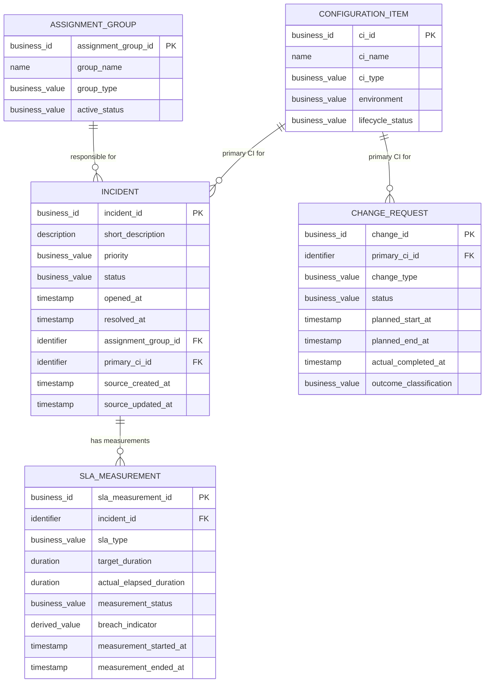

# ITSM Data Warehouse Logical Data Model

## 1. Purpose and scope

This logical model translates the five business entities in the
[business requirements](./business_requirements.md) and
[conceptual model](./conceptual_data_model.md) into a more detailed description
of their attributes, identifiers, relationships, and business-level data
quality rules.

It is still independent of a specific database implementation. It does not
specify SQL data types, physical indexes, storage, SQL statements, or a
dimensional star schema. Required/optional labels below describe the proposed
logical model; where the business requirements have not settled a rule, the
label is explicitly provisional.

The five entities in scope are Incident, SLA Measurement, Assignment Group,
Configuration Item, and Change Request. Only synthetic data for a fictional
ITSM operation is intended.

## 2. Entity and attribute definitions

### 2.1 Identifiers: business, logical, and physical

- A **business identifier** is a recognizable identifier used in business or
  source records, such as `INC10001`. The example is fictional. Similar
  identifiers may exist for SLA measurements, groups, CIs, and changes.
- A **logical entity identifier** is the identifier that uniquely identifies
  one entity instance in the logical model. For the initial proposal, each
  entity's business identifier is also its logical identifier, provided its
  uniqueness within the agreed warehouse scope is confirmed. It is marked `PK`
  in the diagram to mean logical primary identifier, not a database column
  implementation.
- A **physical surrogate key** is an implementation-level identifier that
  could be introduced during physical design, for example to support warehouse
  history or implementation needs. Its presence, format, and data type are not
  decided here. A surrogate key would not replace the need to preserve and
  validate the business identifier.

References between entities below are logical relationships. The diagram marks
the referencing attribute as `FK` so the links are visible; it does not
prescribe a physical foreign-key implementation.

### 2.2 Incident

Represents an IT incident requiring investigation or resolution.

**Business identifier / proposed logical identifier:** `incident_id`, such as
the fictional business identifier `INC10001`. It must be present and unique in
the agreed source and warehouse scope. Whether source identifiers are globally
unique or scoped to a source system remains open.

| Attribute | Required? | Business meaning |
| --- | --- | --- |
| `incident_id` | Required | Business identifier and proposed logical identifier for the incident. |
| `short_description` | Optional; confirm | Brief, synthetic summary of the reported issue. No real personal or client information should be included. |
| `priority` | Required in the proposed analytical record; allowed values unresolved | Relative urgency or impact classification used to prioritize incident work. |
| `status` | Required; allowed values unresolved | Current or final recorded lifecycle state represented by this incident record. The exact status list and snapshot/event meaning must be agreed. |
| `opened_at` | Required for records used in time-based analysis; source requirement to confirm | Timestamp of the agreed incident start event. Its business meaning and timezone convention must be confirmed. |
| `resolved_at` | Optional | Timestamp at which the incident met the agreed resolution condition. It is absent for unresolved incidents and may also be unavailable for incomplete source records. |
| `assignment_group_id` | Required under the initial relationship assumption; source completeness to confirm | Reference to the primary assignment group in the incident's final recorded state. This does not assert that the group was constant over time. |
| `primary_ci_id` | Required under the simplifying initial model; source completeness to confirm | Reference to the one primary CI associated with the incident in this version. Incidents affecting no CI or multiple CIs require a future rule or model extension. |
| `source_created_at` | Optional; include if supplied and useful | Timestamp when the source record was created. It is distinct from the incident's business opening time. |
| `source_updated_at` | Optional; include if supplied and useful | Timestamp when the source record was last updated. It may help assess freshness but does not preserve the full change history. |

**Logical uniqueness:** `incident_id` is unique per incident within the confirmed
identifier scope. A duplicate or missing identifier is a data-quality issue,
not a reason to silently merge records.

### 2.3 SLA Measurement

Represents one measurement of one SLA obligation associated with an incident.
An incident may have multiple measurements, such as separate response-time and
resolution-time measurements.

**Business identifier / proposed logical identifier:** `sla_measurement_id`.
It must uniquely identify one measurement. The source of this identifier and
its uniqueness scope remain to be confirmed.

| Attribute | Required? | Business meaning |
| --- | --- | --- |
| `sla_measurement_id` | Required | Business identifier and proposed logical identifier for this individual measurement. |
| `incident_id` | Required | Reference to the one incident to which this measurement belongs. |
| `sla_type` | Required to classify a complete measurement; domain unresolved | The kind of obligation measured, for example response time or resolution time. |
| `target_duration` | Optional for incomplete or ineligible records; required for breach evaluation | Applicable target duration for this measurement. It can vary by incident or measurement context; a single target must not be assumed for all incidents. |
| `actual_elapsed_duration` | Optional for incomplete or ineligible records; required for breach evaluation | Actual elapsed time measured for this SLA obligation, under the agreed clock rules. |
| `measurement_status` | Required if supplied by the source; required domain unresolved | State that indicates whether the measurement is pending, complete, ineligible, or otherwise represented. Exact values and meaning need confirmation. |
| `breach_indicator` | Derived and optional until evaluable | Indicates whether the eligible, complete actual elapsed duration exceeds its applicable target under agreed business rules. It must not be treated as false merely because required values are missing. |
| `measurement_started_at` | Optional; required only if needed by the agreed measurement definition | Timestamp when the measured obligation began. |
| `measurement_ended_at` | Optional; required only when the measurement definition requires an end event | Timestamp when the measurement ended or was completed. It may be absent for an incomplete measurement. |

**Logical uniqueness:** `sla_measurement_id` uniquely identifies one
measurement. No uniqueness rule is proposed for the combination of incident
and SLA type: repeated measurements of the same type may be valid until the
measurement grain is confirmed.

### 2.4 Assignment Group

Represents a team responsible for handling incidents.

**Business identifier / proposed logical identifier:** `assignment_group_id`.
It must uniquely identify one group within the agreed scope.

| Attribute | Required? | Business meaning |
| --- | --- | --- |
| `assignment_group_id` | Required | Business identifier and proposed logical identifier for the group. |
| `group_name` | Required | Human-readable name of the fictional group. Its uniqueness is not assumed because names may be reused or changed. |
| `group_type` | Optional; confirm usefulness | Function or service area of the group, if the synthetic source defines one. |
| `active_status` | Required in the proposed model; value set unresolved | Indicates whether the group is considered active or inactive under an agreed definition. |

**Logical uniqueness:** `assignment_group_id` is unique. `group_name` is not a
logical identifier and is not assumed unique.

### 2.5 Configuration Item

Represents an IT component, such as a fictional application, server, or
database.

**Business identifier / proposed logical identifier:** `ci_id`. It must
uniquely identify one CI within the agreed scope.

| Attribute | Required? | Business meaning |
| --- | --- | --- |
| `ci_id` | Required | Business identifier and proposed logical identifier for the CI. |
| `ci_name` | Required | Human-readable name of the fictional component. Its uniqueness is not assumed. |
| `ci_type` | Required; valid values unresolved | Category of component, such as application, server, or database. |
| `environment` | Optional; confirm | Environment in which the CI operates, if this distinction is represented in the synthetic data. |
| `lifecycle_status` | Required in the proposed model; value set unresolved | Indicates the CI's lifecycle or active state under an agreed definition. |

**Logical uniqueness:** `ci_id` is unique. `ci_name` is not assumed unique.

### 2.6 Change Request

Represents a planned modification to an IT service or configuration item.

**Business identifier / proposed logical identifier:** `change_id`. It must
uniquely identify one change request within the agreed scope.

| Attribute | Required? | Business meaning |
| --- | --- | --- |
| `change_id` | Required | Business identifier and proposed logical identifier for the change request. |
| `primary_ci_id` | Required under the initial relationship assumption; source completeness to confirm | Reference to the one primary CI associated with this change request in the initial model. |
| `change_type` | Required if needed to answer agreed change questions; domain unresolved | Business category of the planned change. |
| `status` | Required; allowed values unresolved | Lifecycle state of the change request. Exact values and which statuses count as completed must be agreed. |
| `planned_start_at` | Optional until source and process requirements are confirmed | Planned start timestamp for the change. |
| `planned_end_at` | Optional until source and process requirements are confirmed | Planned end timestamp for the change. |
| `actual_completed_at` | Optional | Timestamp when the change was actually completed. It is absent when no completion event has occurred or the source does not provide it. |
| `outcome_classification` | Optional until outcome is known; domain unresolved | Classification of the change result, including whether it meets the approved failed-change definition. Missing or ineligible outcomes are not assumed successful. |

**Logical uniqueness:** `change_id` is unique. The classification of a change as
failed must use the agreed outcome rules, not an assumption based only on a
missing completion timestamp or a non-final status.

## 3. Primary business identifiers and uniqueness

Each entity has one proposed business identifier that serves as its logical
identifier in the initial model:

| Entity | Proposed business/logical identifier | Uniqueness expectation |
| --- | --- | --- |
| Incident | `incident_id` | Unique within the confirmed source and warehouse scope. |
| SLA Measurement | `sla_measurement_id` | Unique per individual measurement within the confirmed scope. |
| Assignment Group | `assignment_group_id` | Unique per group within the confirmed scope. |
| Configuration Item | `ci_id` | Unique per CI within the confirmed scope. |
| Change Request | `change_id` | Unique per change request within the confirmed scope. |

The values and uniqueness scope must be confirmed from the planned synthetic
source definitions. If a business identifier is not stable or unique enough
for a logical identifier, the logical design must be revised before physical
implementation. A physical surrogate key may later be added, but that is an
implementation decision and does not remove the need to retain business
identifiers for traceability.

## 4. Relationships and cardinalities

The diagram uses `||` for exactly one and `o{` for zero or many. An `FK`
annotation marks an attribute that refers to another entity's logical
identifier; it does not specify a database constraint.

| Relationship | Cardinality and meaning |
| --- | --- |
| Assignment Group — Incident | One Assignment Group may be responsible for zero or many Incidents. Each Incident has one primary Assignment Group in its final recorded state under the initial model. Earlier reassignment history is not represented. |
| Configuration Item — Incident | One CI may be associated with zero or many Incidents. Each Incident has one primary CI in the initial version, as a simplifying assumption rather than a universal ITSM rule. |
| Incident — SLA Measurement | One Incident may have zero or many SLA Measurements. Each SLA Measurement belongs to exactly one Incident in the initial model. Multiple measurement types or repeated measurements are allowed; their detailed grain remains open. |
| Configuration Item — Change Request | One CI may be associated with zero or many Change Requests. Each Change Request has one primary CI in the initial version. |

The initial one-group and one-primary-CI relationships follow the requested
conceptual assumptions. The business requirements separately identify whether
these references are mandatory in every source record as an open question. A
missing source reference must therefore be reported, not hidden; final
mandatoryness should be confirmed before physical constraints are designed.

**Attributes versus relationships:** `assignment_group_id` on Incident,
`primary_ci_id` on Incident and Change Request, and `incident_id` on SLA
Measurement are shown as attributes because they carry a reference value in
this logical representation. The business meaning is the relationship between
the associated entities. A future logical refinement could express a
many-to-many or historical relationship using an additional associative
structure if the business rules require it.

## 5. Logical data-quality rules

These rules describe expected business-level consistency. Values that depend on
unconfirmed domains or definitions are proposals, not finalized business
decisions.

1. **Identifiers:** Each required business identifier must be present and
   unique within its confirmed scope. Missing or duplicate identifiers must be
   flagged for investigation; records must not be silently merged.
2. **Priority and status:** Incident priority and lifecycle status must use
   documented valid values once their domains are agreed. Unknown or blank
   values must be identified, not silently mapped to an invented value.
   Assignment-group active status, CI type and lifecycle status, SLA type and
   measurement status, and change type, status, and outcome classification
   likewise require documented domains before strict validation can be final.
3. **Chronological timestamps:** Timestamps used together must be parseable and
   comparable under one agreed timezone convention. `resolved_at` must not
   precede `opened_at`. When both planned change timestamps exist,
   `planned_end_at` should not precede `planned_start_at`. When SLA start and
   end timestamps are both required and present, the end must not precede the
   start. Contradictory timestamps must be flagged and excluded from affected
   duration calculations.
4. **Valid references:** Each populated assignment-group or CI reference must
   identify a known entity. Each SLA Measurement must identify an Incident.
   Missing references and populated-but-unmatched references are different
   quality conditions. The intended primary group and CI references are
   required by the initial model, but their source-level completeness is still
   an open question.
5. **Unresolved incidents:** `resolved_at` is optional for an unresolved
   incident. An incident must not be considered resolved solely because a
   timestamp is present or absent; the agreed status and resolution rules
   determine resolution. Unresolved or incomplete records are excluded from
   resolved counts and resolution-time averages.
6. **Incomplete or ineligible SLA measurements:** Target duration, actual
   elapsed duration, measurement end time, and breach indicator may be missing
   when a measurement is incomplete or ineligible. Such a measurement must not
   be treated as compliant or breached until eligibility and required values
   are established. A breach indicator is evaluated by comparing actual
   elapsed duration with that measurement's applicable target, subject to
   agreed clock and boundary rules.
7. **Change outcomes:** Change outcome classifications must come from an
   agreed, consistent domain. Only approved outcomes count as failed. Open,
   cancelled, incomplete, or otherwise ineligible changes must not be silently
   classified as successes or failures.
8. **No invented repairs:** Missing values, invalid values, and unmatched
   references must be reported or handled under an agreed quality process;
   they must not be replaced with fabricated business facts.

## 6. Assumptions and limitations

### Assumptions for this initial logical model

- The model covers the five entities specified by the business requirements
  and conceptual model.
- The business identifier for each entity can serve as its logical identifier
  if its uniqueness and stability are confirmed.
- An incident has one primary assignment group in its final recorded state.
- An incident and a change request each have one primary CI in the initial
  version. This is a simplifying assumption.
- One incident can have multiple SLA Measurements, including separate
  response-time and resolution-time measurements.
- Each SLA Measurement belongs to one incident in this initial model.
- Missing or incomplete measurements are possible and do not by themselves
  indicate compliance or breach.
- The project uses only synthetic data for a fictional ITSM operation.

### Limitations

- Assignment-group and CI references show the final/primary relationship only;
  they do not preserve historical assignments or CI associations. This does
  not mean groups or CIs cannot change over time.
- One primary CI per incident and change request cannot represent zero or
  multiple CIs in a complete real-world process. A future extension may need
  relationship history or a many-to-many structure.
- The exact source grain, allowed domain values, requiredness of some
  attributes, timestamp conventions, and SLA/change outcome rules are not yet
  settled.
- This model does not specify physical keys, SQL data types, storage,
  indexes, ETL behavior, or an analytical star schema.

## 7. Open questions requiring confirmation

1. Are business identifiers unique across all source history, or only within a
   source system or period? Are they stable enough to be the logical
   identifiers?
2. What are the allowed priority and incident-status values? Can they change
   during an incident's lifecycle?
3. Which status and event define resolution? How should reopened incidents be
   represented?
4. Is an assignment group mandatory for every incident? Should the model
   capture every assignment over time or only the final recorded group?
5. Can an incident have no CI or multiple CIs? Should the primary CI be
   mandatory in source records?
6. Can a change request have no CI or affect multiple CIs? Is one primary CI
   sufficient for the required analysis?
7. What is the grain of an SLA Measurement? Can repeated measurements of the
   same type occur, and what identifies an individual measurement?
8. Which SLA statuses, incidents, and measurements are eligible? Which target
   applies, and how are pauses, resets, business calendars, and incomplete
   measurements handled?
9. Is a measurement equal to its target compliant or breached? The current
   business definition says breach when actual elapsed time exceeds the target,
   subject to agreed rules.
10. Which timezone and timestamp conventions apply? Which source timestamps
    correspond to business opening, resolution, and SLA measurement events?
11. What are the valid assignment-group, CI, SLA, and change status/type
    domains? Are group names and CI names unique or historically reusable?
12. Which change outcomes qualify as failed, and which completed changes form
    the change failure rate denominator?
13. Should historical changes to group and CI descriptive attributes be
    retained, potentially using SCD Type 2, and which reporting date should
    select the applicable version?
14. Should source-created and source-updated timestamps be available for all
    source datasets, and are they business events or source-record metadata?

These decisions should be confirmed or explicitly deferred before the logical
model is treated as final and before physical constraints or KPI calculations
are fixed.

## 8. Embedded logical ER diagram

The attribute labels before each name are descriptive logical categories for
the diagram, not SQL data types. `PK` identifies the proposed logical entity
identifier; `FK` marks a relationship reference.

## 9. How this differs from the conceptual model

The conceptual model names the business entities and explains their
relationships at a high level. This logical model keeps those same entities
and cardinalities, then adds candidate attributes, business identifiers,
required/optional status, uniqueness expectations, reference rules, and
data-quality expectations. It remains independent of SQLite or another
physical database design.
