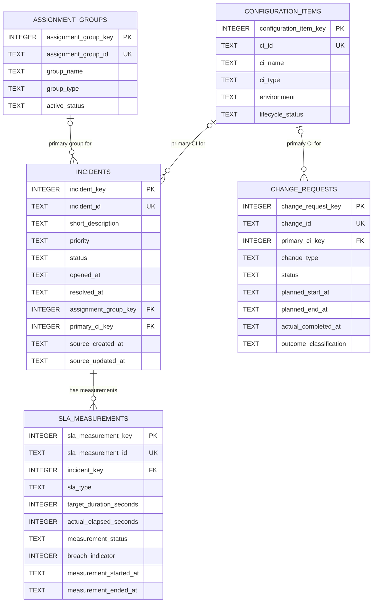

# ITSM Data Warehouse Physical Data Model (SQLite)

## Purpose and scope

This document translates the
[logical data model](./logical_data_model.md) into a proposed, lightweight
SQLite design. It defines five tables, their columns, keys, relationships, and
physical constraints. It documents the implemented SQLite schema in
[`../sql/schema.sql`](../sql/schema.sql), alongside the physical design
decisions and remaining open questions. The project also includes synthetic CSV
data, a Python validator and loader, and four SQL analytics queries.

The design is for synthetic ITSM data representing a fictional operation. This
model remains relational; it does not define a star schema or staging area, or
describe a production deployment.

## SQLite data types and representation choices

SQLite uses **flexible typing**: a column's declared type expresses its
intended affinity, but SQLite does not enforce data types as strictly as some
other database systems. This design uses `INTEGER` for surrogate keys and
durations, and `TEXT` for business identifiers, descriptions, categories, and
timestamps. The Python loader and validator check source values in addition to
the constraints enforced by SQLite.

### Timestamps

All timestamps are represented as `TEXT` in a consistent ISO 8601 format. The
proposed convention is normalized UTC with a trailing `Z`, for example
`2026-10-23T08:32:00Z`. UTC is a practical proposal, not a confirmed business
decision: the timezone, treatment of source offsets, and required precision
must be confirmed before data generation and loading.

SQLite does not provide a dedicated timestamp storage type. Timestamp strings
must be parsed and checked by the loading and validation process. Invalid or
contradictory timestamps should be reported and excluded from affected duration
calculations rather than silently corrected.

### Durations

Durations are represented as whole-number **seconds** in `INTEGER` columns.
Using one unit for both targets and actual elapsed measurements permits direct
comparison. Negative durations are invalid and are prohibited with a
non-negative `CHECK` constraint. The unit and whole-second precision are
physical design proposals; confirm whether source measurements require finer
precision or business-time calculations.

### Surrogate and business identifiers

Each table has an integer surrogate primary key for warehouse relationships.
SQLite's `INTEGER PRIMARY KEY` is its row identifier alias; the design does not
use `AUTOINCREMENT`, which is unnecessary for ordinary unique row identity.

Each entity also retains its source/business identifier in a separate `TEXT`
column with `NOT NULL`, `UNIQUE`, and a `CHECK` that rejects empty or
whitespace-only values. These values support source traceability and duplicate
detection. Their uniqueness scope (for example, one source system or all
source history) still needs confirmation. Surrogate keys do not replace
business identifiers. The implemented schema in
[`../sql/schema.sql`](../sql/schema.sql) enforces an equivalent of
`CHECK (length(trim(identifier_column)) > 0)` for each of the five business
identifier columns.

## Tables

In the constraints below, **baseline** means supported by the current
requirements or logical model. **Proposed** means it is a physical choice or
enforcement of a rule whose business details remain open. Domain values are
not restricted to invented enumerations.

### `assignment_groups`

**Purpose:** Stores the fictional teams that may be responsible for incidents.

**Grain:** One row per assignment group in the loaded source scope.

**Primary key:** `assignment_group_key` — integer warehouse surrogate key.

**Business identifier:** `assignment_group_id` — retained source/group
identifier; unique within the confirmed identifier scope.

| Column | SQLite type | Null? | Meaning and constraints |
| --- | --- | --- | --- |
| `assignment_group_key` | `INTEGER` | No | Surrogate primary key (`PRIMARY KEY`). |
| `assignment_group_id` | `TEXT` | No | Source/business identifier (`UNIQUE`); `CHECK (length(trim(assignment_group_id)) > 0)` rejects empty or whitespace-only values. |
| `group_name` | `TEXT` | No | Human-readable group name. Not unique; names may change or be reused. |
| `group_type` | `TEXT` | Yes | Optional team function or service area. |
| `active_status` | `TEXT` | No | Active/inactive state. Allowed values are not constrained until agreed. |

**Constraints:** `assignment_group_id` must be non-null, unique, and non-empty.
The implemented schema in [`../sql/schema.sql`](../sql/schema.sql) enforces the
non-empty rule with a check equivalent to
`CHECK (length(trim(assignment_group_id)) > 0)`, so blank strings cannot
bypass `NOT NULL` and `UNIQUE`. `active_status` is required by the logical
model, but its values and historical meaning remain unresolved.

### `configuration_items`

**Purpose:** Stores fictional applications, servers, databases, and other
agreed IT components.

**Grain:** One row per configuration item in the loaded source scope.

**Primary key:** `configuration_item_key` — integer warehouse surrogate key.

**Business identifier:** `ci_id` — retained source/CI identifier; unique within
the confirmed identifier scope.

| Column | SQLite type | Null? | Meaning and constraints |
| --- | --- | --- | --- |
| `configuration_item_key` | `INTEGER` | No | Surrogate primary key (`PRIMARY KEY`). |
| `ci_id` | `TEXT` | No | Source/business CI identifier (`UNIQUE`); `CHECK (length(trim(ci_id)) > 0)` rejects empty or whitespace-only values. |
| `ci_name` | `TEXT` | No | Human-readable component name; not assumed unique. |
| `ci_type` | `TEXT` | No | Component category, such as application, server, or database. Allowed values need agreement. |
| `environment` | `TEXT` | Yes | Optional environment description, if included in the synthetic source. |
| `lifecycle_status` | `TEXT` | No | Lifecycle or active state. Allowed values need agreement. |

**Constraints:** `ci_id` must be non-null, unique, and non-empty. The
implemented schema in [`../sql/schema.sql`](../sql/schema.sql) enforces this
with a check equivalent to
`CHECK (length(trim(ci_id)) > 0)`. No `CHECK` list is assigned to `ci_type` or
`lifecycle_status` because their business domains are not yet approved.

### `incidents`

**Purpose:** Stores incident records for volume, priority, ownership,
resolution, and CI analysis.

**Grain:** One row per incident as represented by the source. Whether the
source will provide one current/final record per incident or lifecycle
snapshots/events is unresolved; this table models one consolidated record per
incident for the initial version.

**Primary key:** `incident_key` — integer warehouse surrogate key.

**Business identifier:** `incident_id` — retained incident identifier; unique
within the confirmed source and warehouse scope.

| Column | SQLite type | Null? | Meaning and constraints |
| --- | --- | --- | --- |
| `incident_key` | `INTEGER` | No | Surrogate primary key (`PRIMARY KEY`). |
| `incident_id` | `TEXT` | No | Source/business incident identifier (`UNIQUE`); `CHECK (length(trim(incident_id)) > 0)` rejects empty or whitespace-only values. |
| `short_description` | `TEXT` | Yes | Brief synthetic summary; never include real personal or client information. |
| `priority` | `TEXT` | No | Incident priority. Required by the proposed logical model; valid values and ordering remain unresolved. |
| `status` | `TEXT` | No | Incident lifecycle status. Valid values and snapshot meaning remain unresolved. |
| `opened_at` | `TEXT` | Yes | Timestamp of the agreed incident start event. Kept nullable until source completeness and event meaning are confirmed; the current validator flags missing or invalid values. |
| `resolved_at` | `TEXT` | Yes | Resolution timestamp; nullable for unresolved or incomplete incidents. |
| `assignment_group_key` | `INTEGER` | Yes | Surrogate reference to `assignment_groups.assignment_group_key` (`FOREIGN KEY`). Nullability is provisional because source-level mandatoryness is unresolved. |
| `primary_ci_key` | `INTEGER` | Yes | Surrogate reference to `configuration_items.configuration_item_key` (`FOREIGN KEY`). Nullability is provisional because the source may omit a CI; one primary CI is a simplifying model assumption. |
| `source_created_at` | `TEXT` | Yes | Optional timestamp when the source record was created; distinct from incident opening time. |
| `source_updated_at` | `TEXT` | Yes | Optional timestamp when the source record was last updated. |

**Constraints:** `incident_id` must be non-null, unique, and non-empty. The
implemented schema in [`../sql/schema.sql`](../sql/schema.sql) enforces this
with a check equivalent to
`CHECK (length(trim(incident_id)) > 0)`. `priority` and `status` are required
in the logical model, but no allowed-value checks are added until domains are
agreed. Group and CI keys are foreign keys when populated, while nullable
columns preserve missing-source information until mandatoryness is resolved.
`opened_at` remains nullable because source completeness has not been
confirmed; the current validator flags missing or invalid values. A separate
aggregate count of affected records remains a future enhancement.
`resolved_at` remains nullable for unresolved incidents. No timestamp-format
`CHECK` is used; `src/validate_data.py` validates timestamp formats and
chronology, while `src/load_data.py` loads the source data into SQLite.

### `sla_measurements`

**Purpose:** Stores each individual SLA obligation measurement linked to an
incident.

**Grain:** One row per individual measurement. An incident can have zero or
many rows, for example separate response-time and resolution-time measurements
or repeated measurements if the final grain allows them.

**Primary key:** `sla_measurement_key` — integer warehouse surrogate key.

**Business identifier:** `sla_measurement_id` — retained measurement identifier;
unique within the confirmed measurement/source scope.

| Column | SQLite type | Null? | Meaning and constraints |
| --- | --- | --- | --- |
| `sla_measurement_key` | `INTEGER` | No | Surrogate primary key (`PRIMARY KEY`). |
| `sla_measurement_id` | `TEXT` | No | Source/business measurement identifier (`UNIQUE`); `CHECK (length(trim(sla_measurement_id)) > 0)` rejects empty or whitespace-only values. |
| `incident_key` | `INTEGER` | No | Required surrogate reference to `incidents.incident_key` (`FOREIGN KEY`). |
| `sla_type` | `TEXT` | Yes | Measurement type, such as response or resolution. Nullable for incomplete source records; domain unresolved. |
| `target_duration_seconds` | `INTEGER` | Yes | Applicable target duration in seconds. Nullable when unavailable or not yet applicable; non-negative when present (`CHECK`). |
| `actual_elapsed_seconds` | `INTEGER` | Yes | Actual measured duration in seconds. Nullable when incomplete or ineligible; non-negative when present (`CHECK`). |
| `measurement_status` | `TEXT` | Yes | Source measurement state, if available. Nullable because incomplete records and source semantics are unresolved. |
| `breach_indicator` | `INTEGER` | Yes | `1` for breach, `0` for not breached, `NULL` when not evaluable. Present values limited to 0 or 1 (`CHECK`). |
| `measurement_started_at` | `TEXT` | Yes | Optional start timestamp when provided and meaningful for the measurement. |
| `measurement_ended_at` | `TEXT` | Yes | Optional end timestamp; may be absent for an incomplete measurement. |

**Constraints:** `sla_measurement_id` must be non-null, unique, and non-empty;
the implemented schema in [`../sql/schema.sql`](../sql/schema.sql) enforces
this with a check equivalent to
`CHECK (length(trim(sla_measurement_id)) > 0)`. Each measurement must reference
one incident. No uniqueness rule is placed on `(incident_key, sla_type)`
because repeated measurements may be valid. Durations and breach indicator
are nullable; missing SLA information is not implicitly considered compliant
or breached. The indicator's allowed numeric representation is a physical
choice, while breach eligibility and comparison rules remain business
decisions.

### `change_requests`

**Purpose:** Stores planned modifications to IT services or CIs and their
recorded outcomes.

**Grain:** One row per change request as represented by the source. Event or
version history is not represented in this initial table.

**Primary key:** `change_request_key` — integer warehouse surrogate key.

**Business identifier:** `change_id` — retained change identifier; unique
within the confirmed source scope.

| Column | SQLite type | Null? | Meaning and constraints |
| --- | --- | --- | --- |
| `change_request_key` | `INTEGER` | No | Surrogate primary key (`PRIMARY KEY`). |
| `change_id` | `TEXT` | No | Source/business change identifier (`UNIQUE`); `CHECK (length(trim(change_id)) > 0)` rejects empty or whitespace-only values. |
| `primary_ci_key` | `INTEGER` | Yes | Surrogate reference to `configuration_items.configuration_item_key` (`FOREIGN KEY`). Nullable pending confirmation that every change must reference a CI. |
| `change_type` | `TEXT` | Yes | Business type/category of change; allowed values and requiredness remain to be confirmed. |
| `status` | `TEXT` | No | Change lifecycle status. Required by the logical model; valid values unresolved. |
| `planned_start_at` | `TEXT` | Yes | Planned change start timestamp, when supplied. |
| `planned_end_at` | `TEXT` | Yes | Planned change end timestamp, when supplied. |
| `actual_completed_at` | `TEXT` | Yes | Actual completion timestamp; nullable until a completion event is recorded. |
| `outcome_classification` | `TEXT` | Yes | Recorded outcome or failure classification. Nullable until available; missing outcome is not treated as success. |

**Constraints:** `change_id` must be non-null, unique, and non-empty; the
implemented schema in [`../sql/schema.sql`](../sql/schema.sql) enforces this
with a check equivalent to
`CHECK (length(trim(change_id)) > 0)`. `primary_ci_key` is a foreign key when
populated but remains nullable pending the business decision on mandatory CI
references. `status` is required, while the domain and the rule for completed
or failed changes remain unresolved. Outcome is nullable and must not be
defaulted to success.

## Relationships and diagram cardinalities

The proposed foreign keys are:

- `incidents.assignment_group_key` references
  `assignment_groups.assignment_group_key`.
- `incidents.primary_ci_key` references
  `configuration_items.configuration_item_key`.
- `sla_measurements.incident_key` references `incidents.incident_key`.
- `change_requests.primary_ci_key` references
  `configuration_items.configuration_item_key`.

One group or CI may therefore be referenced by many child records. Incident
group/CI and change CI foreign-key columns are nullable for now because their
source completeness is an open question in the business requirements and
logical model. The diagram reflects that current physical optionality. The
intended initial business relationship remains one primary group/CI per
incident and one primary CI per change request once those references are
present. This does not claim that an assignment or CI relationship can never
change historically.

Every SLA measurement must reference one incident. An incident may have no
measurement or many measurements. No delete-cascade behavior is proposed:
referenced parent records should not be removed in a way that silently removes
or loses child history. Exact update/delete handling can be confirmed during
implementation.

## Constraint summary: confirmed versus proposed

### Supported by current requirements

- Each entity requires a business identifier; duplicate identifiers must be
  identified rather than silently merged.
- A populated group or CI reference must resolve to a known entity; missing and
  unmatched references should be distinguished.
- An SLA measurement belongs to an incident, and one incident may have multiple
  measurements.
- Unresolved incidents may have no resolution timestamp.
- Incomplete or ineligible SLA measurements may lack targets, actual
  durations, end timestamps, or an evaluable breach result.
- A missing change outcome does not mean success, and an unapproved outcome
  must not be classified as failed.
- Durations must not be negative under the proposed elapsed-duration
  interpretation; confirm whether source values may require another
  representation.

### Physical choices or business details still proposed

- Integer surrogate keys and the exact surrogate-key column names.
- Retaining business IDs as unique, non-null `TEXT` values, with a SQL
  `CHECK (length(trim(column_name)) > 0)` for each identifier:
  `assignment_group_id`, `ci_id`, `incident_id`, `sla_measurement_id`, and
  `change_id`. These three constraints are required by this physical design
  and must be included when the SQL schema is created; identifier scope and
  source stability still need confirmation.
- Which attributes are `NOT NULL`, especially incident priority/status and
  group/CI descriptive states, even though the logical model marks them
  required.
- Nullable group and CI foreign keys while source mandatoryness is unresolved.
  Once confirmed, `NOT NULL` may be appropriate for the relevant relationship.
- ISO 8601 UTC `Z` timestamps and whole-second duration precision.
- Domain checks for priority, statuses, SLA type/status, CI type/status, group
  status, change type, and change outcomes. Their allowed values are not yet
  defined, so this design does not invent them.
- Timestamp parsing and chronology enforcement in the ingestion/validation
  process rather than a simplistic SQLite `CHECK`.
- SLA eligibility, measurement status semantics, and the rule that sets the
  nullable breach indicator.

## Data-quality and load handling

- **Duplicate business identifiers:** reject or quarantine the conflicting
  source rows for review; do not merge them silently. The agreed source scope
  must be used when deciding whether two identifiers are duplicates.
- **Invalid references:** populated foreign keys must resolve to their parent
  surrogate key. Report unmatched references before loading. Do not invent a
  parent record or silently replace the reference. If an optional source
  reference is absent, store `NULL` and report it where required; if later
  confirmed mandatory, reject or quarantine the row instead.
- **Invalid timestamps:** validate ISO 8601 parsing, timezone convention, and
  chronology before loading. Report invalid values and exclude affected
  records from duration KPIs; do not silently normalize a contradictory
  timestamp.
- **Missing or invalid incident opening timestamps:** keep `incidents.opened_at`
  nullable. The current Python validator flags incidents where `opened_at` is
  missing or invalid; a separate aggregate count of affected records remains a
  future enhancement. Do not replace missing values with fabricated timestamps.
  Exclude affected incidents only from time-based calculations that require a
  valid opening timestamp; retain them for other analyses where appropriate.
- **Incomplete SLA data:** preserve unavailable values as `NULL`. Do not set
  `breach_indicator` to 0 merely because target, actual duration, or eligibility
  information is missing.
- **Missing change outcome:** preserve it as `NULL`; do not infer a successful
  outcome from a missing value or status.
- **SQLite foreign-key enforcement:** SQLite foreign-key checks must be enabled
  on each database connection for declared foreign keys to be enforced. The
  current loader enables this setting on its connection; any other connection
  using the database must enable it as well.

## Assumptions, limitations, and decisions to confirm

1. **Timezone and precision:** Confirm UTC normalization, trailing `Z`, source
   offset handling, and whether whole-second precision is sufficient.
2. **Duration semantics:** Confirm whether the stored duration is calendar
   elapsed time or SLA/business time, and whether seconds are sufficient for
   every measurement.
3. **Required references:** Confirm whether every incident requires an
   assignment group and primary CI, and every change request requires a primary
   CI. Until then, these three FK columns remain nullable.
4. **Business identifier scope:** Confirm uniqueness and stability for all
   identifiers, especially SLA measurement IDs across repeated or refreshed
   source extracts.
5. **Valid domains:** Define allowed priority, lifecycle/status, SLA, group,
   CI, and change-outcome values before adding domain `CHECK` constraints.
6. **Timestamp chronology:** Confirm the incident start/resolution events,
   handling of reopened incidents, planned change boundaries, and SLA
   start/end meaning.
7. **SLA evaluation:** Confirm eligibility, target source, pauses/resets,
   multiple measurements, exact target boundary, and when `breach_indicator`
   should be populated.
8. **Change classification:** Confirm which outcomes count as failed and which
   changes belong in the failure-rate denominator.
9. **Historical tracking:** These tables represent a single loaded
   assignment/CI state. If historical assignments, CI associations, or
   descriptive changes must be reported, the design may require additional
   history structures or a revised relationship model. Assignment groups and
   CIs are not assumed to remain unchanged over time.
10. **Source record grain and reloads:** Confirm whether incidents and changes
    arrive as one consolidated row or as snapshots/events, and whether future
    loads rebuild or incrementally update the warehouse.

The physical constraints should be finalized only after these decisions are
made. Proposed checks are not substitutes for explicit business rules or
load-time data-quality reporting.

## Embedded SQLite ER diagram

The relationship symbols reflect the current physical nullability: an Incident
may have zero or one referenced primary group and CI until source mandatoryness
is confirmed; a Change Request may have zero or one referenced primary CI.
Each SLA Measurement must reference exactly one Incident. The diagram is
documentation, not executable SQL.
